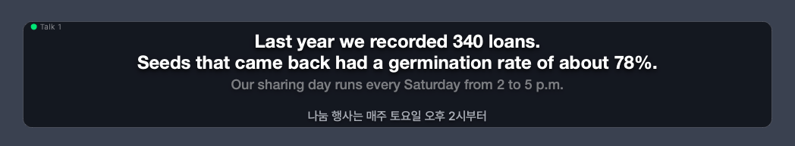
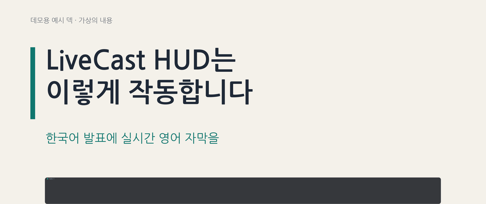

# LiveCast HUD

[한국어](README.ko.md)

LiveCast HUD shows live English subtitles for a Korean talk on top of your slides. It
listens to the speaker, recognizes Korean speech with Google Cloud Speech-to-Text, and
shows English in a slim bar over a full-screen PowerPoint or Keynote slideshow. If you
prepared a script, it matches what you say to that script and shows the English you
wrote yourself, with no cloud translation at all.



## Demo



This was made in demo mode (no microphone): the app typed a script and drew the bar, and the
frames put the app's own bar over the deck's slides at its real position on a 2560x1080 screen.
Live mode uses Google speech recognition instead.

- [Demo deck (PPTX)](examples/demo-deck.pptx) and its [slide images](docs/demo/). The deck is
  made-up, neutral content in Korean, set in the free Nanum Gothic font.
- Play it yourself: `livecast-hud --config examples/demo-talk.json`
- Full-size frames: [one](docs/demo/demo-1.png), [two](docs/demo/demo-2.png)

## Why use it

- **Your English, not a guess.** Sentences from your script show the translation you
  prepared, and your glossary keeps names and terms right.
- **Stays out of the way.** The bar floats above full-screen slides and lets clicks pass
  through, so your clicker and mouse keep driving the slides.
- **Try it in a minute, offline.** Demo mode needs no microphone, no account and no
  network.

## Requirements

- macOS. The overlay depends on macOS window features.
- Python 3.10 or newer.
- Optional, for live subtitles: a Google Cloud project with billing turned on, and the
  [Google Cloud CLI](https://cloud.google.com/sdk/docs/install) (`gcloud`).

## Quick start (demo, no cloud)

```sh
git clone https://github.com/adalgu/livecast-hud.git && cd livecast-hud
python3 -m pip install -e .
livecast-hud --config examples/talks.json
```

A subtitle bar appears at the bottom of your main screen and plays the example talk
sentence by sentence, over and over (add `--exit-on-end` to play it once). Nothing is
sent over the network.

To quit, press `Ctrl+C` in the terminal. You can also click the bar and press `Esc`.

Tip: to keep the packages apart from your other Python projects, create a virtual
environment before the install step:
`python3 -m venv .venv && source .venv/bin/activate`.

## Live subtitles with Google Cloud

Live mode sends your voice to Google and costs money, so it takes a one-time setup.
Replace `YOUR_PROJECT_ID` with your own project ID.

1. Install the Google Cloud extras:

   ```sh
   python3 -m pip install -e '.[gcp]'
   ```

2. Turn on the two APIs in a project that has billing turned on. Speech-to-Text is
   always needed for live mode. Cloud Translation is only used with `--mt gcp`.

   ```sh
   gcloud services enable speech.googleapis.com translate.googleapis.com --project YOUR_PROJECT_ID
   ```

3. Sign in with Application Default Credentials (ADC). LiveCast HUD bills API usage to
   the project you set in step 4.

   ```sh
   gcloud auth application-default login
   ```

   Optional: if you set `LIVECAST_GCP_ACCOUNT`, LiveCast HUD asks `gcloud` for an access
   token for that account instead of using ADC.

4. Tell LiveCast HUD which project to use. Either pass `--gcp-project YOUR_PROJECT_ID`
   every time, or set it once in your shell:

   ```sh
   export LIVECAST_GCP_PROJECT=YOUR_PROJECT_ID
   ```

5. Find your microphone's number. This only lists devices; nothing is recorded.

   ```sh
   livecast-hud --list-devices
   ```

6. Start live subtitles. Use your microphone's number from step 5.

   ```sh
   livecast-hud --config examples/talks.json --mode live --stt gcp --device 1
   ```

For a real talk, `scripts/run_live.sh` runs the same thing with a safety switch. It
refuses to start until you set `LIVECAST_GCP_CONFIRMED=1`, so a test run can never start
billing by accident. It starts with click-through on. It does not pick a config file
for you, so pass `--config` or set `LIVECAST_CONFIG`.

```sh
LIVECAST_GCP_CONFIRMED=1 scripts/run_live.sh --config examples/talks.json --device 1
```

**Microphone permission.** The first time, macOS asks whether your terminal app
(Terminal, iTerm2 and so on) may use the microphone. Click **Allow**. If you clicked
**Don't Allow**, turn it on in **System Settings → Privacy & Security → Microphone** and
restart the terminal. Without this permission macOS sends silence, and no subtitles
appear.

**No other permissions.** LiveCast HUD does not need Screen Recording or Accessibility
permission. It only draws its own window. It never reads the screen or keystrokes meant
for other apps.

**What it costs, roughly.** Prices below are from Google's official pages, checked on
2026-10-22. They can change, so check them before your talk:
[Speech-to-Text pricing](https://cloud.google.com/speech-to-text/pricing),
[Cloud Translation pricing](https://cloud.google.com/translate/pricing).

| Service | Used with | Price | One hour of talk |
| --- | --- | --- | --- |
| Speech-to-Text (V1 API, standard models, data logging off) | `--stt gcp` | First 60 minutes each month free, then US$0.024 per minute | About US$1.44 |
| Cloud Translation (NMT) | `--mt gcp` only | First 500,000 characters each month free, then US$20 per million characters | At most about 400,000 characters, usually inside the free amount |

In short, one hour of live subtitles costs about US$1.50. If you also use `--mt gcp`
after the free characters run out, add up to about US$8. Rehearsals cost the same as
the talk.

## Using it with PowerPoint or Keynote full screen

1. Start LiveCast HUD first, then start the slideshow. The bar is a full-screen auxiliary
   window that joins every Space, so it stays visible over the slideshow. It has no Dock
   icon and does not take focus away from the slides.
2. Turn click-through on, with `--click-through` or by pressing `C` on the bar. Clicks
   and keys then go to the slides instead of the bar.
3. With a projector: if you mirror the screen, there is nothing to do. If you extend the
   desktop (for example, for Presenter View), pass the projector's screen number with
   `--screen N`. The app prints the list of screens when it starts.
4. If the bar covers content at the bottom of your slides, use `--position top`.
5. Rehearse once on the real setup. Display arrangements and app versions differ.

**Once click-through is on, the bar ignores the mouse and the keyboard.** Use the
terminal commands below to switch talks or show the Korean line. To move the bar or turn
click-through off again, quit with `Ctrl+C` and start again with `--no-click-through`.

`Ctrl+C` in the terminal always removes the bar at once.

## Keys and terminal commands

### Keys

Click the bar first. Keys work only while click-through is off.

| Key | Action |
| --- | --- |
| `1` / `2` | Move the bar to the bottom / top of the screen |
| `T` or `K` | Show or hide the Korean line |
| `F1` … `F9` | Switch to talk 1 … 9 (on a MacBook, add `fn`) |
| `C` | Turn click-through on. After that the bar gets no keys, so use the terminal |
| `+` / `-` | Bigger / smaller text |
| `Esc` or `Q` | Quit |
| Drag with the mouse | Move the bar |


### Terminal commands

These work even while click-through is on. Type them in the terminal that started the
app, then press Enter.

| Type | Action |
| --- | --- |
| `1` … `9` | Switch to talk 1 … 9 |
| `k` | Show or hide the Korean line |

A number that is not in your config prints a notice and is ignored. `Ctrl+C` (no Enter
needed) quits.

### Command-line options

Run `livecast-hud --help` for the same list.

| Option | What it does |
| --- | --- |
| `--config PATH` | Config file with your talks, scripts and terms. Default: `LIVECAST_CONFIG`. Demo mode needs one |
| `--mode demo\|file\|live` | `demo` (default) plays script sentences without a microphone. `file` plays a WAV file in real time. `live` uses the microphone |
| `--audio PATH` | WAV file for `--mode file` (16 kHz, mono, 16-bit) |
| `--stt offline\|gcp` | Speech recognition. `offline` (default) is a test stand-in for `--mode file` that reads `<file>.timing.json` next to the WAV. `gcp` is Google Cloud Speech-to-Text |
| `--mt script\|gcp` | Where the English comes from. `script` (default) shows your prepared English for sentences in the script and leaves the line empty otherwise. `gcp` sends everything else to Google Cloud Translation |
| `--talk N` | Talk to start with, 1 to 9. Default: the lowest number in the config |
| `--gcp-project ID` | Google Cloud project. Default: `LIVECAST_GCP_PROJECT` |
| `--device ID` | Microphone number, or part of its name |
| `--list-devices` | List microphones and exit. Records nothing |
| `--screen N` | Screen to show the bar on. Default: the main screen |
| `--position bottom\|top` | Where to put the bar. Default: bottom |
| `--click-through` / `--no-click-through` | Start with click-through on / off |
| `--en-only` | Show English only and hide the Korean line |
| `--log PATH` | Write what was shown, with timings, to a JSON Lines file |
| `--exit-on-end` | Quit 3 seconds after the audio file ends, or after one pass of the demo |
| `--snapshot-at SECONDS` / `--snapshot-dir DIR` | For testing: save a PNG of the bar at the given times (comma-separated) |
| `--version` | Print the version and exit |

| Environment variable | Meaning |
| --- | --- |
| `LIVECAST_CONFIG` | Default for `--config` |
| `LIVECAST_GCP_PROJECT` | Default for `--gcp-project` |
| `LIVECAST_GCP_ACCOUNT` | Optional. Get access tokens from `gcloud` for this account instead of ADC |
| `LIVECAST_GCP_CONFIRMED` | Set to `1` to let `scripts/run_live.sh` start |

## Use your own script and terms

Everything specific to a talk lives in one JSON config file, not in the code. Start from
the example: copy it, edit the copy, and point `--config` at it.

```sh
cp -R examples my-talk
livecast-hud --config my-talk/talks.json
```


The config file holds:

- **`talks`.** Up to nine talks, keyed `"1"` to `"9"`. Each has a `name`, a `script`
  path (relative to the config file) and, for demo mode, the sentence ids to play.
- **Script file.** Your sentences as Korean and English pairs. With `--mt script`, when
  you say something close to a sentence in the script, the bar shows its English.
- **`glossary`.** Korean terms with the English that must always be used, such as names
  and product terms, plus the ways people tend to say them.
- **`hints`.** Words that speech recognition should expect, such as names and jargon.
- **`spoken_fixes`, `english_fixes`, `match_aliases`.** Corrections for words that
  speech recognition or translation keeps getting wrong, and other ways of saying a
  phrase in your script.

Put a field at the top level to share it with every talk, or inside one talk to use it
only there.

A script file needs only this much:

```json
{"sentences": [
  {"id": "s1", "ko": "오늘 발표를 시작하겠습니다.", "en": "Let me begin today's talk."}
]}
```

Tips:

- Write one sentence per entry, the way you will actually say it.
- Numbers and times may be read out in different ways. The matcher already treats common
  spoken forms of numbers and times as the same.
- Off-script remarks get no English with `--mt script`. Use `--mt gcp` if you want them
  machine-translated.

Full reference: [docs/configuration.md](docs/configuration.md).

## How it works

1. Audio comes from the microphone (or a WAV file) in 100 ms chunks.
2. Speech-to-Text streams back partial and final Korean results. The app moves to a fresh
   stream before Google's per-stream time limit (about 5 minutes). If the connection
   drops, the last subtitle stays on screen and the status dot turns amber until it
   reconnects.
3. Each piece of Korean is matched against your script, looking a few sentences ahead,
   so the English can appear before you finish the sentence. With `--mt gcp`, speech
   that is not in the script goes to Cloud Translation, at most one in-progress request
   every 0.8 seconds.
4. The bar shows two finished English lines, two dimmer lines for the sentence in
   progress and, if you want, the Korean line.

Diagram and details: [docs/architecture.md](docs/architecture.md).

## Privacy and limitations

Privacy:

- With `--stt gcp`, your microphone audio is streamed to Google Cloud Speech-to-Text in
  your project. With `--mt gcp`, the recognized Korean text is sent to Cloud Translation.
  Google Cloud's terms for your project apply.
- Demo mode, and file mode with `--stt offline --mt script`, make no network calls at
  all.
- If your audience or co-speakers should know that their voices go to a cloud service,
  tell them before you start.
- A `--log` file contains everything that was recognized. Keep it private.

Limitations:

- macOS only. The overlay depends on macOS window features.
- Built for Korean speech with English subtitles. Recognition is set to Korean and
  translation to English.
- Script matching works best when you stay close to your script.
- Live mode needs a steady internet connection. A few words can be lost while the app
  moves to a fresh stream or reconnects.
- Up to nine talks per config (`F1` to `F9`).
- `--stt offline` is not real speech recognition. It replays a timing file for tests.

## Development

```sh
python3 -m pip install -e '.[dev]'
QT_QPA_PLATFORM=offscreen python3 -m pytest
ruff check .
```

The tests never touch the network or the microphone. See
[CONTRIBUTING.md](CONTRIBUTING.md) before you send a pull request, and
[SECURITY.md](SECURITY.md) to report a security problem privately. Release notes are in
[CHANGELOG.md](CHANGELOG.md).

## License

Copyright 2026 Kunwoo Kim

Licensed under the [Apache License 2.0](LICENSE). See also [NOTICE](NOTICE).
