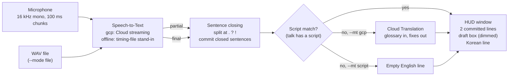

# Architecture

LiveCast HUD turns Korean speech into English subtitles in a small always-on-top window. Every stage runs on
your Mac except the two optional Google Cloud calls.

## Stages

| Stage | Code | What it does |
| --- | --- | --- |
| Capture | `stt.py` `LivecastSTTEngine._capture`, `FileAudioSource` | Microphone through `sounddevice`, or a WAV file streamed in real time (chunk k leaves at (k+1)·0.1 s) |
| Recognition | `stt.py` `LivecastSTTEngine` | Cloud Speech-to-Text v1 streaming, `ko-KR`, `latest_long`, interim results, glossary and hints as phrase hints. Rotates to a new stream every 270 s (before the 5-minute limit) without dropping audio; after an error it shows "disconnected", waits 1 s, and reconnects with a fresh token |
| Offline stand-in | `stt.py` `OfflineScriptSTT` | For tests: replays `<audio>.timing.json` as partial and final results at their audio times |
| Debounce | `pipeline.py` `Pipeline.on_partial` | Partial results reach the screen at most every 0.35 s |
| Sentence closing | `pipeline.py` `Pipeline._emit_gcp`, `_close` | A sentence closed by `.` `?` `!` inside a partial is committed once. A period at the very end is ignored until more speech follows, because streaming partials add and remove it |
| Script match | `translate.py` `ScriptMatcher` | Fuzzy match of a normalized key (spoken forms, aliases, number and time readings) against the talk script, preferring the next few sentences. Partials can lock on early |
| Translation | `translate.py` `GcpTranslator`, `pipeline.py` `MTWorker` | Cloud Translation v3 on a worker thread: the newest partial only, every final in order, partials at most every 0.8 s. Proper nouns are inserted before, feared mistranslations and spellings fixed after. Late results for older partials are dropped |
| Display | `overlay.py` `SubtitleOverlayWindow` | Two committed English lines on top, a smaller dimmed draft box below, one Korean line. Fixed height (≤150 px, ≤130 px without Korean) at the bottom edge; floats over full-screen Keynote and PowerPoint on macOS |

## Failure behavior

- Recognition or translation failure keeps the last subtitle on screen and turns the corner dot amber.
- Tokens, accounts and project ids are never printed; error messages pass through `stt.redact`.
- `--mt script` and `--stt offline` make no network calls. The test suite asserts zero external calls per test.

## Threads

- Qt main thread: window, keys, a 100 ms timer that watches for the end of input.
- Recognition thread (and a file reader thread in file mode).
- Translation worker thread (`--mt gcp`).
- A terminal reader thread for `1`–`9` and `k` commands, which still work while the window ignores the mouse.

Cross-thread updates go through Qt signals (`SubtitleSignals`).
